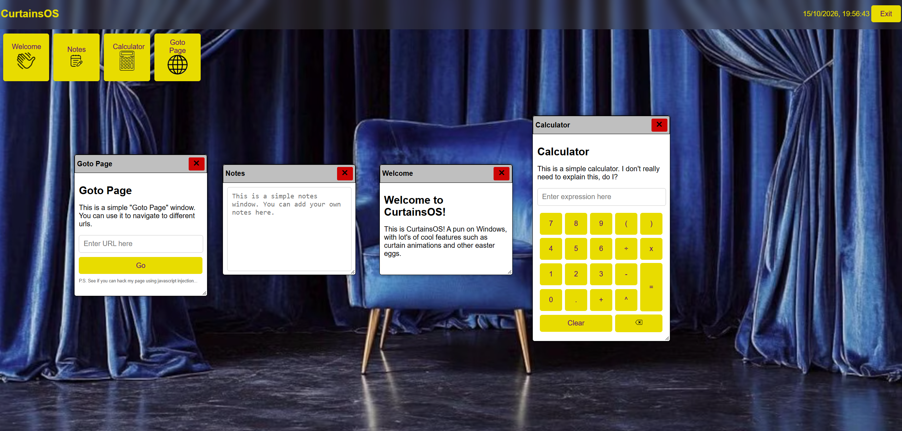

# CurtainsOS
This is CurtainsOS! A pun on Windows, with lot's of cool features such as curtain animations and other easter eggs. 

## Features
- Button animations (scale on hover)
- Curtain animations (Don't credit me, I used AI overview because I had no idea how, but I learnt how it works now)
- A welcome window (of course)
- Notes app (haven't added saving yet)
- Calculator app with basic functions, typing, buttons and ANS
- A couple easter eggs (you'll have to find them yourself)
- A goto app, where you can goto a website, a search, or inject javascript to hack the system 😈
- Nice styling (sooo much css!)
- A cool background with some curtains (cause why not?)
- Draggable windows
- **Resizeable** windows (doesn't work right on mobile devices that don't support standard css `resize: both;`)
- Top bar with blur and time
- Randomly placed windows on open
- Auto window raising (when you click on them)
- Custom HTMLElements (`<app-window>`s) to make the adding of windows easy-peasy
- More?...

## Credits
- Almost all of the underlying code: [@zacianculovici](https://github.com/zacianculovici)
- Minor code completions: GitHub Copilot
- Curtain animations: AI Overview, but I learnt how to do it along the way

---
&copy; 2026 - Zac Ianculovici | [Contact](mailto:zachary.ianculovici@gmail.com) | [Slack](https://hackclub.enterprise.slack.com/team/U0BMLT1CFB3) | [Stardance](https://stardance.hackclub.com/@zac_i/)
